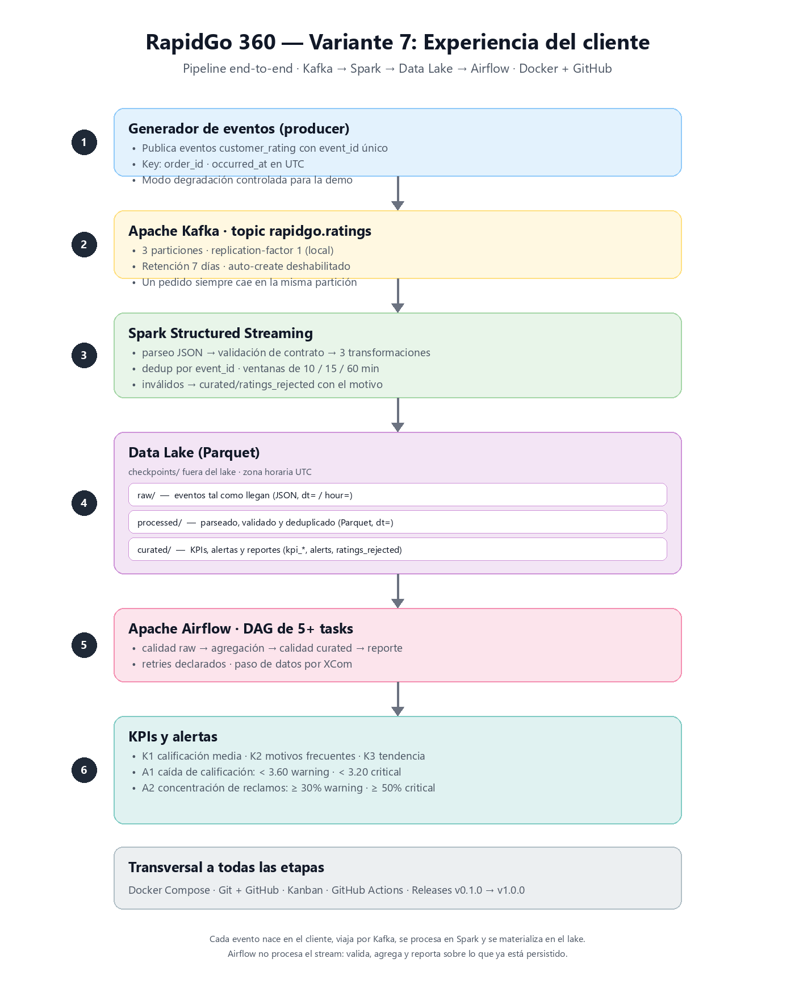

# RapidGo 360 — Variante 7: Experiencia del cliente

Pipeline Big Data end-to-end que detecta el deterioro de la satisfacción del cliente
durante el servicio de entregas de RapidGo, a partir de calificaciones, motivos de
reclamo y canal de contacto.

**Equipo 7** — Línea de Profundización I (Big Data)
Ingeniería de Sistemas y Computación · Facatativá · 2026

| Integrante | Usuario GitHub |
| --- | --- |
| Andres Maldonado | [FelipeMaldonado10](https://github.com/FelipeMaldonado10) |
| Ivan Palacio | [AzopG](https://github.com/AzopG) |
| Luis Jaraba | [vannysys](https://github.com/vannysys) |

## Video de la demo

[](https://youtu.be/eJebgEh0Bro)

La demostración completa del pipeline, con la grabación de pantalla y la voz en off de los
tres integrantes, está publicada en YouTube: <https://youtu.be/eJebgEh0Bro>.

## Problema de negocio

RapidGo no tiene forma de saber, en el momento en que ocurre, que la experiencia del
cliente se está deteriorando. Las calificaciones bajas y los reclamos se descubren
tarde, cuando el pedido ya terminó y el cliente ya decidió no volver a usar la
plataforma.

La variante 7 busca **detectar la caída de satisfacción mientras el servicio ocurre** y
**concentrar los reclamos por motivo, canal y zona**, para que operación pueda actuar
antes de que el deterioro se vuelva una tendencia.

## Alcance de la variante

| Elemento | Definición |
| --- | --- |
| Eventos mínimos | `calificacion`, `motivo`, `canal`, `pedido`, `timestamp` |
| KPIs mínimos | calificación media · motivos frecuentes · tendencia de satisfacción |
| Alertas mínimas | caída de calificación · concentración de reclamos |

Los umbrales iniciales están en [`docs/kpis-alerts.md`](docs/kpis-alerts.md) y se ajustan
con evidencia de ejecución real. El contrato del evento vive en
[`docs/event-contract.md`](docs/event-contract.md) y la decisión de key y particiones en
[`docs/decisions/ADR-001-kafka-key-partitions.md`](docs/decisions/ADR-001-kafka-key-partitions.md).

## Arquitectura



```
Generador de eventos (producer)
        |
        v
      Kafka  (topic: rapidgo.ratings, key: order_id)
        |
        v
Spark Structured Streaming
  parseo -> validacion -> transformaciones -> ventanas -> KPIs y alertas
        |
        v
Data Lake: raw/ -> processed/ -> curated/   (Parquet + checkpoint)
        |
        v
Apache Airflow: calidad -> agregacion -> reporte
        |
        v
Indicadores y alertas
```

Diagrama editable: [`docs/arquitectura.png`](docs/arquitectura.png). El bloque de texto
de arriba resume el mismo flujo para quien lee sin imágenes.

## Stack

| Tecnología | Rol |
| --- | --- |
| Python | generador de eventos, pruebas y lógica de negocio |
| Apache Kafka | transporte de eventos en tiempo real |
| Apache Spark Structured Streaming | procesamiento, ventanas, KPIs y alertas |
| Data Lake (Parquet) | persistencia en capas raw / processed / curated |
| Apache Airflow | orquestación, calidad, reintentos y reporte |
| Docker Compose | ejecución local de toda la arquitectura |
| GitHub Actions | integración continua y quality gate |

## Estructura del repositorio

```
rapidgo-variant/
├── .github/workflows/     # CI, quality gate y release
├── airflow/dags/          # DAGs de orquestación
├── orchestration/         # contexto y comandos que arma el DAG (sin Airflow)
├── docker/airflow/        # imagen de Airflow con Java + PySpark (ADR-003)
├── producer/              # generador de eventos
├── spark/                 # jobs de Structured Streaming
├── scripts/               # utilidades de infraestructura (topic, spark, verificación)
├── tests/                 # pruebas de contrato y reglas de negocio
├── samples/               # eventos de ejemplo
├── datalake/              # estructura del data lake (raw/processed/curated)
├── docs/
│   ├── arquitectura.png
│   ├── contribuciones.md  # tabla generada desde el historial de GitHub
│   ├── checkpoints/       # semana1.md, semana2.md, semana3.md
│   └── decisions/         # ADR-001, ADR-002, ADR-003, ADR-004
├── docker-compose.yml
├── requirements.txt
├── README.md
└── .gitignore
```

## Prerrequisitos

- Docker Desktop con Docker Compose v2
- Python 3.13
- Docker con acceso a internet la primera vez (descarga la imagen de Spark y el conector)

## Ejecución local

### 1. Levantar Kafka

```bash
docker compose up -d kafka
```

El contenedor queda `healthy` cuando el broker responde a `kafka-topics.sh`.

### 2. Crear el topic `rapidgo.ratings`

```bash
python -m venv .venv
.venv\Scripts\activate          # Linux/macOS: source .venv/bin/activate
pip install -r requirements.txt

python -m scripts.create_topic
```

Salida esperada la primera vez:

```text
estado observado: topic=rapidgo.ratings exists=False ...
accion: create
rapidgo.ratings: creado
estado final: topic=rapidgo.ratings exists=True partitions=3 replication_factor=1 retention_ms=604800000 ...
```

El script es **idempotente**: en la segunda corrida informa `accion: noop` y no toca
el broker. Si el topic existiera con otra cantidad de particiones o factor de
replicación, falla con un mensaje explícito, porque esas propiedades no se pueden
reducir sin perder datos.

Configuración que impone (ADR-001): 3 particiones, replication-factor 1, retención de
7 días (`604800000` ms) y `cleanup.policy=delete`. La creación automática de topics está
deshabilitada en el broker, así que el topic existe únicamente porque este script lo crea.

Verificación manual:

```bash
docker exec rapidgo-kafka /opt/kafka/bin/kafka-topics.sh \
  --bootstrap-server localhost:9092 --describe --topic rapidgo.ratings
```

### 3. Publicar eventos de calificación

```bash
python -m producer.rating_producer --rate 10 --duration 30 --seed 7
```

| Flag | Default | Para qué |
| --- | --- | --- |
| `--rate` | `5.0` | eventos por segundo |
| `--duration` | `30.0` | segundos de corrida (`--rate` × `--duration` = eventos) |
| `--seed` | aleatoria | semilla: la misma semilla reproduce la misma secuencia |
| `--degradation` | `0.0` | proporción `0..1` de eventos con rating 1–2 y motivo dominante |
| `--dominant-reason` | `late_delivery` | motivo que se concentra en modo degradación |
| `--backfill-minutes` | `0` | reparte los `occurred_at` en esa ventana hacia atrás (para K3) |
| `--dry-run` | — | genera y muestra eventos sin publicarlos |

Salida al terminar, con los offsets reales por partición:

```text
publicados=50 particiones_usadas=3 duracion_s=4.9 tasa_efectiva=10.2/s
[p0: count=18 last_offset=17, p1: count=13 last_offset=12, p2: count=19 last_offset=18]
```

Para provocar las alertas A1 y A2 en una corrida integrada:

```bash
python -m producer.rating_producer --rate 10 --duration 60 --seed 7 --degradation 0.7
```

### 4. Ejecutar un job de Spark

```bash
python -m scripts.run_spark_job spark/streaming_job.py
```

Spark corre en el contenedor `apache/spark:4.0.1`, no en el host: en Windows nativo Spark
no puede escribir Parquet sin `winutils.exe` y el conector de Kafka falla por la misma
causa. La decisión completa, con la evidencia, está en
[`docs/decisions/ADR-002-spark-execution-environment.md`](docs/decisions/ADR-002-spark-execution-environment.md).

El wrapper se encarga de todo lo que hay que recordar a mano: monta el repo en
`/opt/rapidgo`, se conecta a la red de Kafka, usa `kafka:29092` y fija el connector
`spark-sql-kafka-0-10_2.13:4.0.1` para que coincida con la versión de Spark.

```bash
python -m scripts.run_spark_job spark/streaming_job.py --dry-run   # solo muestra el comando
```

Al terminar, el job imprime el conteo por capa y, para la evidencia, el árbol de
particiones, la distribución de clases y el motivo de cada rechazo:

```text
LAKE raw=100 processed=100 rechazados=6
ARBOL raw: dt=2026-10-28/hour=16
CLASES bueno=76, critico=16, medio=8
MOTIVOS future_occurred_at=1, invalid_channel=1, invalid_occurred_at=1, missing:customer_id=1, missing:complaint_reason=1, rating_out_of_range=1
```

### 5. Alertas A1 y A2

```bash
python -m scripts.run_spark_job spark/alerts_job.py -- --duration 90
```

Evalúa las dos reglas de [`docs/kpis-alerts.md`](docs/kpis-alerts.md) sobre ventanas de
`occurred_at`, global y por zona, y escribe en `datalake/curated/alerts` el valor
observado, el umbral que la disparó y la ventana, para poder auditar por qué sonó.

- **A1:** `avg(rating) < 3.60` con `n >= 20` en 10 minutos → `warning`; `< 3.20` → `critical`.
- **A2:** un motivo con `>= 30%` de los reclamos y `n_reclamos >= 10` en 15 minutos →
  `warning`; `>= 50%` → `critical`.

El cooldown es de 15 minutos por `(alerta, zona, motivo)`. Al arrancar se siembra desde
`curated/alerts`, así que un reinicio no repite una alerta que ya sonó. Para probarlo con
eventos degradados:

```bash
python -m producer.rating_producer --rate 10 --duration 30 --degradation 0.7 --dominant-reason late_delivery
python -m scripts.run_spark_job spark/alerts_job.py -- --once
```

### 6. KPIs y orquestación con Airflow

El DAG `rapidgo_pipeline` corre la corrida completa: crea un topic propio, publica
eventos con `--backfill-minutes 120` (para que K3 tenga los 60 minutos anteriores),
ejecuta ingesta, alertas, el cálculo de los tres KPIs y las tasks de calidad de #16.

```bash
docker compose build airflow-init
docker compose up -d postgres airflow-init
docker compose up -d airflow-webserver airflow-scheduler
```

UI en http://localhost:8080 (`admin` / `admin`). El DAG se dispara a mano
(`schedule=None`) y cada corrida escribe en `datalake/runs/<run_id>/`, con su propio
topic y sus checkpoints. Los reintentos están configurados en `default_args`.

Los jobs de Spark corren dentro del contenedor de Airflow con `--master local[*]`: la
imagen trae Java 17 y PySpark 4.0.1, y el conector de Kafka se resuelve con Ivy. La
decisión y sus límites están en
[ADR-003](docs/decisions/ADR-003-airflow-spark-execution.md).

#### Calidad y reporte (#16)

Las tasks `calidad_raw`, `calidad_curated` y `generar_reporte` llaman a `quality/`,
Python puro que lee el Parquet con `pyarrow` (sin Spark ni Airflow):

| Función | Valida / escribe |
| --- | --- |
| `quality.checks.check_raw(lake_dir)` | `raw` y `processed` no vacíos, esquema del contrato, sin `event_id` duplicado, `processed <= raw`, rechazados con motivo |
| `quality.checks.check_curated(lake_dir)` | K1, K2 y K3 presentes y en rango, `delta` coherente, `curated/alerts` con `ALERT_SCHEMA` |
| `quality.report.build_report(lake_dir, quality)` | `datalake/runs/<run_id>/curated/report/report.json` con los 3 KPIs, las alertas y la calidad |

Las dos funciones de calidad devuelven `{"ok", "checks", "metrics"}`. Un `ok=False` no
falla la task: queda en el reporte. Un error de lectura sí la falla, y Airflow reintenta.

Para ver el reporte de la última corrida:

```bash
docker compose exec airflow-scheduler bash -c "cat \$(ls -d /opt/rapidgo/datalake/runs/*/ | tail -1)curated/report/report.json"
```

El job de KPIs también se puede correr suelto, sobre el lake de la Semana 2:

```bash
python -m scripts.run_spark_job spark/kpis_job.py
```

| Salida | KPI |
| --- | --- |
| `curated/kpi_rating_avg` | media por ventana de 10 min, global y por zona, canal y repartidor |
| `curated/kpi_top_reasons` | top 5 de motivos por ventana de 15 min, con participación |
| `curated/kpi_trend` | últimos 60 min contra los 60 anteriores, con delta y estado |

## Pruebas

```bash
pytest -v
```

Las pruebas no necesitan Kafka ni un cluster de Spark: cubren la lógica pura del
proyecto. La prueba de paridad de K3 sí levanta una sesión local de Spark (`local[1]`)
para comparar el SQL de `spark/kpis_job.py` contra la tabla de `spark/kpi_rules.py`; por
eso necesita Java 17, que el CI fija.

En Windows nativo esa prueba puede fallar aunque el código esté bien: el worker de Spark
no puede escribir sin `winutils.exe` y `HADOOP_HOME`. La validación autoritativa es el CI
Linux, que corre la suite completa en cada push y en cada PR. Ver
[limitaciones](#limitaciones-y-trabajo-futuro).

### CI

Tres jobs en `.github/workflows/ci.yml`:

| Job | Qué corre |
| --- | --- |
| `compileall + pytest + compose` | compilación, la suite completa, las reglas de negocio de la Semana 3 con nombre propio, la estructura del pipeline y `docker compose config` |
| `DAG de Airflow importable y valido (#18)` | `python -m scripts.validate_dag` con `apache-airflow==2.10.4` sobre Python 3.12, más las pruebas del validador y del DAG |
| `Quality Gate end-to-end (#20)` | `python -m scripts.verify_pipeline` completo con Docker, Kafka y Spark sobre un lake temporal; depende de los dos jobs anteriores y publica `.verify/**/resumen.txt` como artefacto obligatorio |

La decisión y el costo medido están en [ADR-004](docs/decisions/ADR-004-ci-dag-validation.md);
el gate end-to-end se detalla en [Resultados](#resultados).

### Verificación end-to-end

Un solo comando levanta Kafka, crea un topic propio de la corrida, publica 300 eventos
degradados, inyecta un evento inválido por cada regla del contrato, corre los dos jobs
`--once` sobre un lake temporal en `.verify/<id>/` y verifica los conteos:

```bash
python -m scripts.verify_pipeline
```

```text
VERIFY publicados=300 inyectados_invalidos=7
VERIFY raw=300 processed=300 rechazados=7 alertas=12
VERIFY resultado=OK
```

Sale con `0` si todo cumple, `1` si los conteos o el lake no cuadran, `2` si falta algo
en la estructura y `3` si falla un paso (Docker, Kafka, producer o Spark), nombrando el
paso. El resumen queda en `.verify/<id>/resumen.txt` como evidencia del checkpoint.

Es el mismo comando que corre el job `quality-gate` en cada push y PR. Sin Docker, para
una revisión rápida de la estructura:

```bash
python -m scripts.verify_pipeline --structure-only
```

## Resultados

Evidencia de la corrida final, medida en un runner limpio de GitHub Actions, no escrita
a mano:

| Indicador | Valor observado |
| --- | --- |
| Eventos publicados | `300` |
| Eventos inválidos inyectados | `7` |
| Filas en `raw` | `300` |
| Filas en `processed` | `300` |
| Rechazados con motivo | `7` |
| Alertas emitidas | `12` |
| Partición del lake | `dt=2026-11-11/hour=21` |
| Resultado del gate | `VERIFY resultado=OK` |
| Duración del quality gate | `1m57s` |

Los tres KPIs y las alertas de esa corrida quedan en
`datalake/runs/<run_id>/curated/report/report.json`:

- **K1** calificación media por ventana de 10 minutos, global y por zona, canal y repartidor.
- **K2** top 5 de motivos de reclamo por ventana de 15 minutos, con participación.
- **K3** tendencia de satisfacción: últimos 60 minutos contra los 60 anteriores, con `delta` y estado.
- **A1** caída de calificación media (`< 3.60` warning, `< 3.20` critical, `n >= 20`).
- **A2** concentración de reclamos (`>= 30%` warning, `>= 50%` critical, `n_reclamos >= 10`).

Corridas de referencia: [43106882082](https://github.com/AzopG/rapidgo-variant/actions/runs/43106882082)
(commit `7e60354`, evidencia medida), [43112789228](https://github.com/AzopG/rapidgo-variant/actions/runs/43112789228)
y [43112804120](https://github.com/AzopG/rapidgo-variant/actions/runs/43112804120)
(commit `6d14d9a`, artefacto obligatorio verificado), y
[43118386025](https://github.com/AzopG/rapidgo-variant/actions/runs/43118386025)
(`main` después del merge del quality gate).

## Limitaciones y trabajo futuro

Limitaciones conocidas de la entrega:

- **Spark en Windows nativo.** Sin `winutils.exe` y `HADOOP_HOME` no puede escribir Parquet
  ni usar el conector de Kafka. Todo corre en contenedor; la suite local de Windows falla
  en la prueba de paridad de K3 y el CI Linux es la validación autoritativa (ADR-002).
- **Ejecución de Spark dentro de Airflow.** Los jobs corren con `--master local[*]` en el
  contenedor de Airflow, no con `spark-submit` contra un cluster. Simplifica el entorno y
  acota el paralelismo a un host (ADR-003).
- **Data Lake en filesystem local.** No hay object storage ni catálogo de tablas
  (Hive, Glue, lakehouse). Las capas `raw`/`processed`/`curated` son directorios Parquet.
- **Fuente sintética.** El productor genera eventos con una distribución configurable; el
  contrato de `docs/event-contract.md` está listo para conectar la app real de RapidGo.
- **Alertas sin notificación externa.** Se persisten en `curated/alerts` con cooldown de
  15 minutos; no hay envío a Slack, correo ni sistema de tickets.
- **Entorno local sin seguridad.** Kafka sin autenticación y Airflow con `admin`/`admin`
  son aceptables para la demo, no para producción.
- **Ventanas acotadas.** A1, A2 y K3 evalúan ventanas de 10, 15 y 60 minutos; no hay
  retención de estado de largo plazo ni detección de tendencias semanales.

Trabajo futuro, en orden de impacto:

1. Conectar el productor a la fuente real y reemplazar el generador sintético.
2. Notificar las alertas a un canal operativo y cerrar el ciclo con el equipo de soporte.
3. Mover Spark a un cluster gestionado y el lake a object storage con catálogo.
4. Agregar tablero de KPIs sobre `curated/` y alertas con supresión por causa raíz.
5. Endurecer el entorno: autenticación en Kafka, usuarios de Airflow y secretos fuera del repo.
6. Pruebas de carga y de caos sobre Kafka y Spark para medir recuperación real.

## Organización del trabajo

- **Tablero Kanban:** https://github.com/users/AzopG/projects/1
- Columnas: `BACKLOG → READY → IN PROGRESS → REVIEW → DONE`
- Campos: `Semana`, `Responsable`, `Prioridad`, `Componente`
- **Backlog:** 23 Issues planificados a lo largo de las cuatro semanas. El tablero es la
  fuente de verdad del estado; cada issue se cierra vía PR con `Closes #NN` en el cuerpo.
- Flujo por cambio: `Issue → Branch → PR → GitHub Actions → Review → Merge`.
- **`workflow_dispatch`:** el CI se puede disparar a mano desde Actions, y cada integrante
  deja al menos una corrida visible desde su propia cuenta.

## Roadmap de releases

| Release | Semana | Alcance | Estado |
| --- | --- | --- | --- |
| `v0.1.0-foundation` | 1 | Arquitectura, contrato de evento, KPIs, alertas, Kanban, ADR-001 | [publicado](https://github.com/AzopG/rapidgo-variant/releases/tag/v0.1.0-foundation) |
| `v0.2.0-streaming` | 2 | Kafka + Spark Streaming + Data Lake + pruebas + CI | [publicado](https://github.com/AzopG/rapidgo-variant/releases/tag/v0.2.0-streaming) |
| `v0.3.0-orchestration` | 3 | DAG de Airflow, calidad, recuperación ante fallos, CI ampliado | [publicado](https://github.com/AzopG/rapidgo-variant/releases/tag/v0.3.0-orchestration) |
| `v1.0.0` | 4 | Quality gate, README final, release y video | [publicado](https://github.com/AzopG/rapidgo-variant/releases/tag/v1.0.0) |

## Equipo y contribuciones

| Integrante | Rol en la entrega | Issues | PRs mergeados | Reviews a PR ajenos | `workflow_dispatch` |
| --- | --- | --- | --- | --- | --- |
| Ivan Palacio (`AzopG`) | Arquitectura, Kafka, productor, DAG de Airflow, quality gate, coordinación | [10](https://github.com/AzopG/rapidgo-variant/issues?q=is%3Aissue+assignee%3AAzopG) | [19](https://github.com/AzopG/rapidgo-variant/pulls?q=is%3Apr+author%3AAzopG+is%3Amerged) | [8](https://github.com/AzopG/rapidgo-variant/pulls?q=is%3Apr+reviewed-by%3AAzopG) | [4](https://github.com/AzopG/rapidgo-variant/actions/workflows/ci.yml?query=event%3Aworkflow_dispatch) |
| Andrés Maldonado (`FelipeMaldonado10`) | Spark, alertas, validación del DAG en CI, release `v1.0.0` | [8](https://github.com/AzopG/rapidgo-variant/issues?q=is%3Aissue+assignee%3AFelipeMaldonado10) | [6](https://github.com/AzopG/rapidgo-variant/pulls?q=is%3Apr+author%3AFelipeMaldonado10+is%3Amerged) | [14](https://github.com/AzopG/rapidgo-variant/pulls?q=is%3Apr+reviewed-by%3AFelipeMaldonado10) | [8](https://github.com/AzopG/rapidgo-variant/actions/workflows/ci.yml?query=event%3Aworkflow_dispatch) |
| Luis Jaraba (`vannysys`) | Verificación end-to-end, CI, calidad de `raw`/`curated` y reporte | [5](https://github.com/AzopG/rapidgo-variant/issues?q=is%3Aissue+assignee%3Avannysys) | [4](https://github.com/AzopG/rapidgo-variant/pulls?q=is%3Apr+author%3Avannysys+is%3Amerged) | [3](https://github.com/AzopG/rapidgo-variant/pulls?q=is%3Apr+reviewed-by%3Avannysys) | [3](https://github.com/AzopG/rapidgo-variant/actions/workflows/ci.yml?query=event%3Aworkflow_dispatch) |

La tabla completa —issue por issue y PR por PR, generada desde el historial real de
GitHub— está en [`docs/contribuciones.md`](docs/contribuciones.md). Se regenera con:

```bash
python -m scripts.contributions --repo AzopG/rapidgo-variant
```

## Enlaces

- Video final: [RapidGo 360 — demo completa](https://youtu.be/eJebgEh0Bro) (#23)
- Release actual: [`v1.0.0`](https://github.com/AzopG/rapidgo-variant/releases/tag/v1.0.0)
- Tablero Kanban: https://github.com/users/AzopG/projects/1
- Contribuciones: [`docs/contribuciones.md`](docs/contribuciones.md)
- Contrato del evento: [`docs/event-contract.md`](docs/event-contract.md)
- KPIs y alertas: [`docs/kpis-alerts.md`](docs/kpis-alerts.md)
