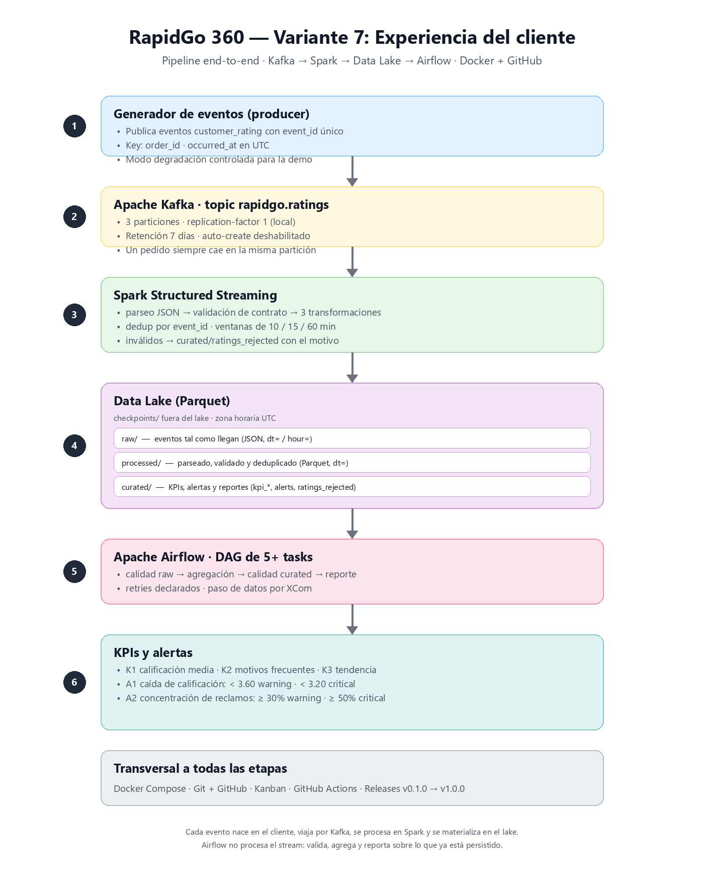

# RapidGo 360 — Variante 7: Experiencia del cliente

Pipeline Big Data end-to-end que detecta el deterioro de la satisfacción del cliente
durante el servicio de entregas de RapidGo, a partir de calificaciones, motivos de
reclamo y canal de contacto.

**Equipo 7** — Línea de Profundización I (Big Data)
Ingeniería de Sistemas y Computación · Facatativá · 2026

| Integrante | Usuario GitHub |
| --- | --- |
| Andres Maldonado | [FelipeMaldonado10](https://github.com/FelipeMaldonado10) |
| Ivan Palacio | [AzopG](https://github.com/AzopG) |
| Luis Jaraba | [vannysys](https://github.com/vannysys) |

## Problema de negocio

RapidGo no tiene forma de saber, en el momento en que ocurre, que la experiencia del
cliente se está deteriorando. Las calificaciones bajas y los reclamos se descubren
tarde, cuando el pedido ya terminó y el cliente ya decidió no volver a usar la
plataforma.

La variante 7 busca **detectar la caída de satisfacción mientras el servicio ocurre** y
**concentrar los reclamos por motivo, canal y zona**, para que operación pueda actuar
antes de que el deterioro se vuelva una tendencia.

## Alcance de la variante

| Elemento | Definición |
| --- | --- |
| Eventos mínimos | `calificacion`, `motivo`, `canal`, `pedido`, `timestamp` |
| KPIs mínimos | calificación media · motivos frecuentes · tendencia de satisfacción |
| Alertas mínimas | caída de calificación · concentración de reclamos |

Los umbrales iniciales están en [`docs/kpis-alerts.md`](docs/kpis-alerts.md) y se ajustan
con evidencia de ejecución real. El contrato del evento vive en
[`docs/event-contract.md`](docs/event-contract.md) y la decisión de key y particiones en
[`docs/decisions/ADR-001-kafka-key-partitions.md`](docs/decisions/ADR-001-kafka-key-partitions.md).

## Arquitectura



```
Generador de eventos (producer)
        |
        v
      Kafka  (topic: rapidgo.ratings, key: order_id)
        |
        v
Spark Structured Streaming
  parseo -> validacion -> transformaciones -> ventanas -> KPIs y alertas
        |
        v
Data Lake: raw/ -> processed/ -> curated/   (Parquet + checkpoint)
        |
        v
Apache Airflow: calidad -> agregacion -> reporte
        |
        v
Indicadores y alertas
```

Diagrama editable: [`docs/arquitectura.png`](docs/arquitectura.png). El bloque de texto
de arriba resume el mismo flujo para quien lee sin imágenes.

## Stack

| Tecnología | Rol |
| --- | --- |
| Python | generador de eventos, pruebas y lógica de negocio |
| Apache Kafka | transporte de eventos en tiempo real |
| Apache Spark Structured Streaming | procesamiento, ventanas, KPIs y alertas |
| Data Lake (Parquet) | persistencia en capas raw / processed / curated |
| Apache Airflow | orquestación, calidad, reintentos y reporte |
| Docker Compose | ejecución local de toda la arquitectura |
| GitHub Actions | integración continua y quality gate |

## Estructura del repositorio

```
rapidgo-variant/
├── .github/workflows/     # CI (y release en Semana 4)
├── airflow/dags/          # DAGs de orquestación
├── producer/              # generador de eventos
├── spark/                 # jobs de Structured Streaming
├── tests/                 # pruebas de contrato y reglas de negocio
├── samples/               # eventos de ejemplo
├── datalake/              # estructura del data lake (raw/processed/curated)
├── docs/
│   ├── arquitectura.png
│   ├── checkpoints/       # semana1.md, semana2.md, semana3.md
│   └── decisions/         # ADR-001, ADR-002, ADR-003
├── docker-compose.yml
├── requirements.txt
├── README.md
└── .gitignore
```

## Prerrequisitos

- Docker Desktop con Docker Compose v2
- Python 3.13
- Git

## Ejecución local

_Pendiente: se completa en la Semana 2, cuando el pipeline Kafka → Spark → Data Lake
esté funcional._

## Pruebas

_Pendiente: `pytest -v` queda activo junto con el workflow de CI en la Semana 2._

## Organización del trabajo

- **Tablero Kanban:** https://github.com/users/AzopG/projects/1
- Columnas: `BACKLOG → READY → IN PROGRESS → REVIEW → DONE`
- Campos: `Semana`, `Responsable`, `Prioridad`, `Componente`
- **Backlog:** 23 Issues abiertos, distribuidos en las cuatro semanas.
- Flujo por cambio: `Issue → Branch → PR → GitHub Actions → Review → Merge`.

## Roadmap de releases

| Release | Semana | Alcance | Estado |
| --- | --- | --- | --- |
| `v0.1.0-foundation` | 1 | Arquitectura, contrato de evento, KPIs, alertas, Kanban, ADR-001 | en curso |
| `v0.2.0-streaming` | 2 | Kafka + Spark Streaming + Data Lake + pruebas + CI | pendiente |
| `v0.3.0-orchestration` | 3 | DAG de Airflow, calidad, recuperación ante fallos, CI ampliado | pendiente |
| `v1.0.0` | 4 | Quality gate, README final, release y video | pendiente |

## Equipo y contribuciones

La tabla de contribuciones (responsabilidades, Issues y PR principales por integrante)
se completa en la Semana 4, a partir del historial real del repositorio.

## Enlaces

- Video final: _pendiente_
- Tablero Kanban: https://github.com/users/AzopG/projects/1
- Contrato del evento: [`docs/event-contract.md`](docs/event-contract.md)
- KPIs y alertas: [`docs/kpis-alerts.md`](docs/kpis-alerts.md)
